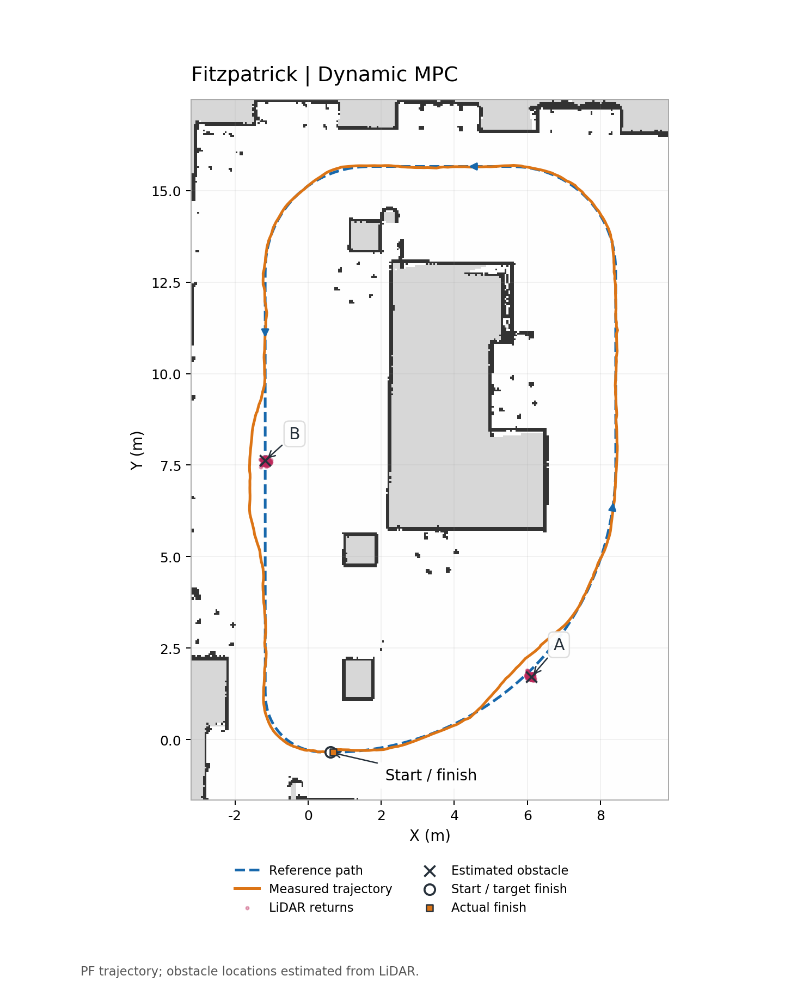

# F1TENTH Takeover

Fixed-route navigation and static-obstacle avoidance on a real F1TENTH vehicle,
plus a laptop-tested dynamic-obstacle overtaking simulation.

**Latest validated result: Dynamic MPC v8, Fitzpatrick, 2026-09-27.** One complete lap with two static obstacles; the operator reported no contact, minimal oscillation, and a natural stop. This is one successful run, not a repeated-trial reliability claim.

| Measure | Result |
|---|---:|
| Route length | 44.73 m |
| Time to completion | 27.98 s |
| Final position error | 7.45 cm |
| RMS error relative to the selected local path | 3.43 cm |
| Maximum commanded speed | 2.0 m/s |
| Active invalid controller messages | 0 |



[Obstacle A](results/fitzpatrick_v8_20260927/obstacle_A_trajectory_en.png) · [Obstacle B](results/fitzpatrick_v8_20260927/obstacle_B_trajectory_en.png) · [Recorded result](results/fitzpatrick_v8_20260927/analysis_summary.json)

## How it works

1. **Localize:** GPU-assisted particle filtering matches LiDAR against a saved map and uses wheel odometry.
2. **Detect:** filter known wall returns, cluster additional returns, and confirm obstacles across observations.
3. **Plan:** a 5 Hz Frenet planner samples smooth quintic lateral detours within an approximately 3.2 m local window. Collision, curvature and continuity checks select the path.
4. **Control:** 20 Hz dynamic MPC jointly optimizes acceleration and steering over 24 steps / 1.2 s, including lateral vehicle dynamics and actuator lag.
5. **Execute:** independent command supervision, freshness checks and the L1 deadman gate vehicle motion.

v8 carries lateral velocity/yaw-rate estimates continuously through the dynamic model. The predicted lateral-acceleration bound is 1.65 m/s²; curvature speed planning still uses 1.20 m/s². These lateral states are model estimates, not independent IMU measurements. Dynamic-obstacle prediction and overtaking are implemented in the isolated laptop simulation, but have not been accepted on the physical vehicle.

## Where to start

- [Current status and version boundaries](docs/STATUS.md)
- [Vehicle commands](docs/OPERATIONS.md)
- [Source/build scope and dependencies](docs/BUILD.md)
- [Curated real-vehicle source snapshot](real_vehicle/)
- [Field evidence and English trajectory figures](results/fitzpatrick_v8_20260927/)
- [Risk-aware following simulation reference](Code/sim_ws/BASELINE_EVALUATION.md)
- [Laptop dynamic-overtaking setup and operation](docs/LAPTOP_TAKEOVER_SIM.md)
- [Current 15-trial overtaking report](results/takeover_sim_20261007/REPORT.md)
- [Historical materials and attribution](docs/HISTORY.md)

## Offline native checks

On Linux with a C++14 compiler, Eigen3, jsoncpp, Python dependencies in `tools/requirements-offline.txt`, and **acados v0.4.0** installed:

```bash
export ACADOS_INSTALL_DIR=/path/to/acados_install
bash tools/build_native.sh
bash tools/test_native.sh
```

These commands build a non-actuating probe and run model tests. They do not launch ROS drivers or move the car. The Git source export is not an already commissioned vehicle installation; see [BUILD.md](docs/BUILD.md).

## Repository scope

| Directory | Purpose |
|---|---|
| `real_vehicle/` | Latest exported physical-vehicle source, configurations, Fitzpatrick map and route |
| `results/` | Selected successful v8 field evidence and English trajectory figures |
| `tools/` | Non-actuating native build and model tests |
| `docs/` | Status, operation, build, provenance and cleanup records |
| `Code/sim_ws/` | Independent risk-aware following simulation and shadow-mode reference |
| `Code/f1tenth_stack/` | Hardware stack reference used by the simulation deployment documentation |

The `Code/` reference implementation is separate from the validated v8 Frenet/dynamic-MPC vehicle release. Its simulation/shadow status does not establish physical acceptance.

Compiled binaries, build/install caches and raw ROS logs are excluded. Original field logs and working vehicle releases remain on the Jetson. Obsolete photos/videos, old maps/trajectories, vision/raceline experiments, duplicate workspaces and hardware-design attachments have been removed from the current tree. [HISTORY.md](docs/HISTORY.md) links to the preserved prior revision; Git history has not been rewritten, so historical large objects still contribute to a full clone's size.

Retained source/package notices and acados, BLASFEO and HPIPM notices remain intact. No new blanket license is applied to third-party or legacy material.
